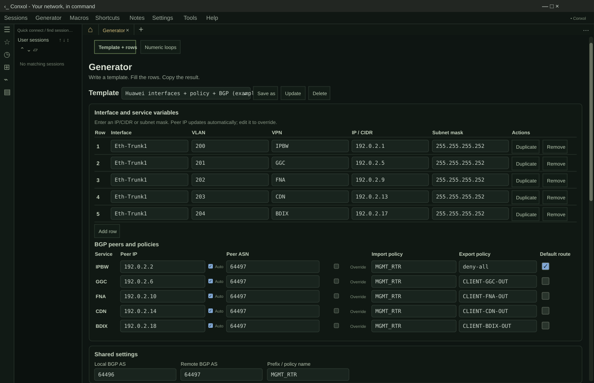

<div align="center">



# Conxol

**Open-source SSH client and network terminal for Windows, macOS and Linux.**

Connect to your devices. Work with remote files. Generate configurations. Find the fault.

[](https://github.com/thetonmoyroy/Conxol/releases/latest) [](#download) [](LICENSE)

**[Website](https://thetonmoyroy.github.io/Conxol/)** &nbsp; / &nbsp; **[Download](#download)** &nbsp; / &nbsp; **[Features](#features)** &nbsp; / &nbsp; **[Config generator](#config-generator)** &nbsp; / &nbsp; **[Documentation](#documentation)**

</div>

Conxol brings **SSH, SFTP/SCP, serial consoles, SSH tunnels and network diagnostics** into one desktop workspace built with Rust and Tauri. It is a free, open-source MobaXterm alternative for network engineers, system administrators, ISP operators and homelab users who want their daily tools together. No cloud account required.

<a id="download"></a>

<!-- Release versions and links are synchronized by tools/sync-public-release.mjs. -->
## Download Conxol 0.1.65

**Windows users: [Get Conxol from the Microsoft Store](https://apps.microsoft.com/store/detail/9NZVQ7W665BH?cid=DevShareMCLPCS)** or choose a standalone installer below.

| Your platform | Package | Download |
| :--- | :--- | :--- |
| **Windows x64** | Installer | [Download EXE](https://github.com/thetonmoyroy/Conxol/releases/download/v0.1.65/Conxol-0.1.65-windows-x64.exe) |
| **macOS · Apple Silicon** | M1 and newer | [Download ARM64 DMG](https://github.com/thetonmoyroy/Conxol/releases/download/v0.1.65/Conxol-0.1.65-macos-arm64.dmg) |
| **macOS · Intel** | x64 | [Download Intel DMG](https://github.com/thetonmoyroy/Conxol/releases/download/v0.1.65/Conxol-0.1.65-macos-x64.dmg) |
| **Linux · Debian / Ubuntu** | x64 | [Download DEB](https://github.com/thetonmoyroy/Conxol/releases/download/v0.1.65/Conxol-0.1.65-linux-x64.deb) |
| **Linux · AppImage** | x64 portable | [Download AppImage](https://github.com/thetonmoyroy/Conxol/releases/download/v0.1.65/Conxol-0.1.65-linux-x64.AppImage) |
| **Android preview · ARM64** | Signed APK · Android 7+ | [Download preview APK](https://github.com/thetonmoyroy/Conxol/releases/download/v0.1.65/Conxol-0.1.65-android-arm64.apk) |

[Release notes & SHA-256 checksums](https://github.com/thetonmoyroy/Conxol/releases/tag/v0.1.65) · [What changed in 0.1.65](docs/release/v0.1.65.md)

[Android preview notes, limitations & signing information](docs/release/v0.1.60-android-preview.1.md) (initial preview). Older debug APKs use a different signing certificate; read the installation note before replacing one.

<details>
<summary>Installation notes</summary>

- **Windows:** run the installer, or use the Microsoft Store listing. The standalone installer is unsigned; the Store listing has its own release schedule.
- **macOS:** open the DMG and move Conxol to Applications. Both Mac packages are ad hoc signed and not notarized.
- **Debian / Ubuntu:** install the DEB with your package manager. Other Linux desktops can use the AppImage; WebKitGTK 4.1 and FUSE may be required.
- **Verification:** compare your download with its platform's SHA-256 manifest on the release page.

</details>

<a id="features"></a>

## Less switching. More work done.

| Connect & work | Diagnose & configure |
| :--- | :--- |
| **SSH terminals, tabs and splits.** Keep multiple devices in view. Branch a connected SSH session into another shell without another login. | **Network diagnostics beside your terminal.** Use DNS reports, TCP checks and bounded CIDR port scans. Float diagnostic panels and export their reports. |
| **SFTP and SCP file transfers.** Browse remote directories, move files with progress and cancellation, and edit remote text with conflict checks. | **Huawei, Cisco and Juniper configuration templates.** Fill shared service rows, preview the commands, then copy or export the result. |
| **Saved sessions that stay organized.** Use nested folders, favorites, recent sessions, search, and custom device icons and colors. | **Commands within reach.** Double-tap Shift to find shared or device-specific shortcuts. Keep notes, snippets and reviewed macros nearby. |

### Current workspace improvements

- **Appearance settings:** unified app and terminal themes, eight additional palettes and Dark/Light previews in Settings > Appearance. Syntax highlighting lives in Settings > Terminal.
- **Faster session layouts:** drag a saved session onto a terminal for a fresh connection in a right split, or onto an empty workspace to connect.
- **Saved Web sessions:** optional PPTP routing; the PPTP Web browser requires Windows WebView2.
- **Telnet login recovery:** unreadable saved passwords fall back to interactive login; replace them in Edit session.

### More than an SSH client

- **Console access:** local shells, Windows WSL, Telnet and serial terminals.
- **SSH port forwarding:** local and remote tunnels, SOCKS5 proxies, bind controls and traffic counters.
- **File-transfer tools:** FTP / explicit FTPS, a TFTP client, and an explicitly started read-only TFTP server for a selected file.
- **Terminal customization:** unified app and terminal palettes, adjustable fonts, search, keyboard shortcuts and editable network-output highlighting.
- **Controlled automation:** snippet previews, macro review and broadcast input for selected targets.
- **Workspace protection:** 4–12 digit numeric PINs and password-encrypted workspace backups with a restore preview.

<a id="config-generator"></a>

## From service rows to router configuration

**One set of variables. Vendor-specific commands.** Turn interface addresses, VLANs, VPN names, prefixes and BGP peers into a configuration you can review before applying.

| Template | Includes |
| :--- | :--- |
| **Huawei** | Subinterfaces, VPN bindings, prefix lists, route policies and BGP peers |
| **Cisco IOS XE** | VRF Lite, dot1Q subinterfaces, prefix lists, route maps and BGP address families |
| **Juniper Junos** | Interface units, virtual-router instances, routing policies and BGP |
| **Juniper logical systems** | Service-specific logical systems with scoped interfaces, policies and routing |

- Enter `192.0.2.1/30`: the subnet mask and automatic peer address follow.
- Set one remote BGP ASN, with an optional override for each service.
- Edit prefix filters, import/export policies and default-route advertisement.
- Save reusable templates, use numeric loops, and copy or export generated text.

Built-in examples use documentation-only IP addresses and ASNs. Saved templates retain command setup and shared settings, not service or prefix rows. The generator produces text; it does not apply configuration to devices.

## Local workspace. Explicit trust.

Conxol keeps settings and saved connection data locally. Rust handles connections, processes, credentials and persistence; saved profiles use credential references. Unknown SSH host keys require fingerprint approval, and changed keys are rejected. Multiline paste and remote execution have review boundaries.

[Security policy](SECURITY.md) · [Threat model](docs/security/threat-model.md) · [Dependency audit](docs/security/dependency-audit.md)

<details>
<summary>Platform and protocol limits</summary>

- Native Ping/MTR currently support IPv4 on Windows, macOS, and the Android preview. IPv6 and Linux probing are not implemented; other diagnostic tools have their own supported transports.
- RDP/VNC support has been removed. Existing saved entries are preserved as unsupported. Telnet traffic is unencrypted.
- RSA private-key authentication is unsupported. RSA-SHA2 server host-signature verification is supported.
- FTP/FTPS client support depends on the system curl build. External X11 forwarding requires an X server.
- Package verification does not establish clean-machine installation or interoperability with every network device.

</details>

<a id="documentation"></a>

## Find your next step

| I want to… | Go to |
| :--- | :--- |
| Learn the workspace and implementation | [Architecture guide](docs/architecture.md) |
| Find keyboard controls | [Keyboard shortcuts](docs/keyboard-shortcuts.md) |
| Run Conxol from source | [Development guide](docs/development.md) |
| See recent changes | [0.1.65 release notes](docs/release/v0.1.65.md) |
| See what's planned | [Roadmap](ROADMAP.md) |
| Report a problem or suggest a feature | [GitHub Issues](https://github.com/thetonmoyroy/Conxol/issues/new/choose) |

<details>
<summary>Build from source</summary>

Install Rust stable **1.90+**, Node.js **22**, pnpm **10**, and the [native Tauri prerequisites](docs/development.md).

```bash
git clone https://github.com/thetonmoyroy/Conxol.git
cd Conxol
pnpm install --dir apps/desktop --frozen-lockfile
pnpm --dir apps/desktop tauri dev
```

For validation, use `pnpm --dir apps/desktop test:unit`, `cargo xtask check-rust`, or the broader `cargo xtask check`. Protocol fixtures use disposable local state; see [safe testing](docs/security/safe-testing.md).

</details>

Front-page release maintenance: run `node tools/sync-public-release.mjs` after publishing all packages, or `node tools/sync-public-release.mjs --check` to detect stale versions. GitHub Pages runs this synchronization on front-page pushes, published releases, a daily schedule and manual dispatch; package builds remain manual. Feature descriptions still require review when functionality changes.

## Open source, with credit

Conxol is independently maintained and builds on [MobaRust](https://github.com/OthmaneBlial/MobaRust), created by Othmane Blial and its contributors. The project is licensed under [Apache-2.0](LICENSE); see [NOTICE](NOTICE) for copyright and third-party attribution.

Bug reports, feature requests and suggestions are welcome. External code contributions and pull requests are not accepted; see the [contribution policy](CONTRIBUTING.md). You may use, modify and fork the project under its license.

---

<div align="center">

**Your terminal. Your devices. Your workspace.**

[Download Conxol](#download) &nbsp; · &nbsp; [Report an issue](https://github.com/thetonmoyroy/Conxol/issues/new/choose) &nbsp; · &nbsp; [Star the project](https://github.com/thetonmoyroy/Conxol)

</div>
