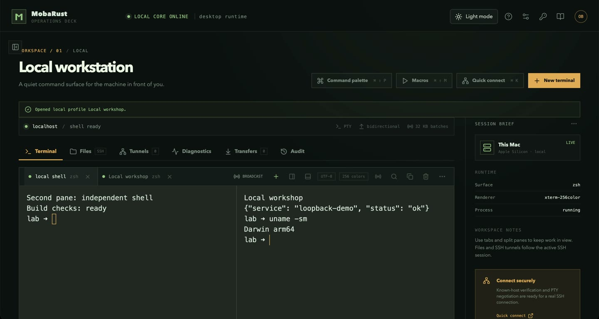
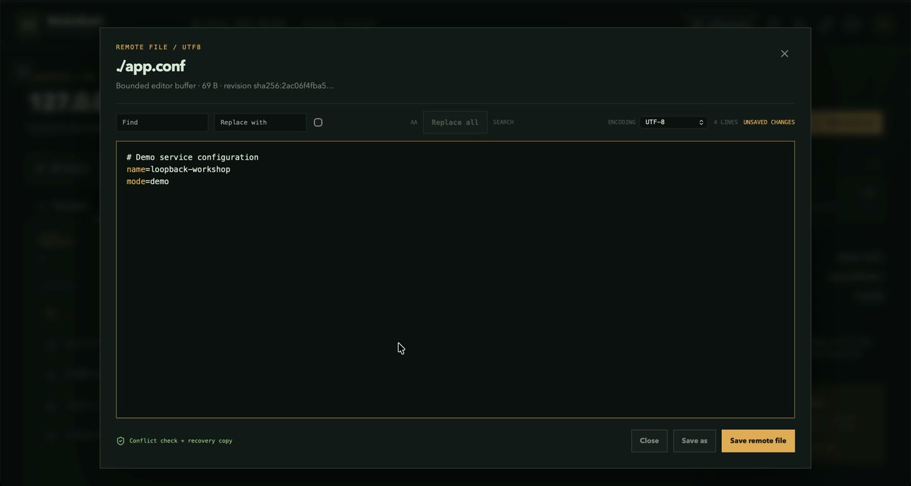

<div align="center">


**Free, open-source MobaXterm alternative built with Rust**

SSH • SFTP/SCP • terminal tabs & splits • remote editing • tunnels • reviewed automation

[](https://github.com/thetonmoyroy/Conxol/releases/tag/v0.1.53)
[](docs/architecture.md)
[](LICENSE)

**[⬇️ Download](#download)** · **[🎬 Watch the app](#demo)** · **[🌐 Website](https://othmaneblial.github.io/MobaRust/)** · **[🧭 Roadmap](ROADMAP.md)** · **[📖 Docs](https://othmaneblial.github.io/MobaRust/docs.html)** · **[🤝 Contribute](CONTRIBUTING.md)**

</div>

<a id="demo"></a>

## 🎬 See the real app

https://github.com/user-attachments/assets/616b444e-6b8a-411e-8075-bac4f58d9d88

**From a shell to a working remote workspace.** A real macOS ARM64 application recording: independent terminal panes, an authenticated SSH session, SFTP browsing and editing, a completed file download, an HTTP request through an SSH tunnel, reusable snippets, and light/dark themes.

[▶ Watch / download the full walkthrough](https://github.com/OthmaneBlial/MobaRust/releases/download/v0.1.17/mobarust-desktop-demo.mp4) · [Recording details & chapters](docs/release/desktop-demo.md)

The server, keys, files and HTTP service are disposable loopback fixtures. The recording shows working product flows; it is not evidence of production-server or cross-platform compatibility.

## ✨ One workspace, from connection to completion


<table>
<tr>
<td width="50%" valign="top">

### 🖥️ Keep your terminals together

Local shells and SSH terminals share a workspace. Open tabs, split panes, search scrollback and keep independent tasks in view. Organize saved sessions with **folders, tags, favorites, recents and search**.



</td>
<td width="50%" valign="top">

### 📂 Work directly with remote files

Browse SFTP files, download or upload, and edit remote text without leaving the app. Transfers expose **progress and cancellation**; the editor checks for remote changes before saving.



</td>
</tr>
<tr>
<td width="50%" valign="top">

### 🔐 Make trust explicit

Connect with passwords, keys, encrypted keys or an SSH agent. Verify unknown host fingerprints, import an OpenSSH config deliberately, and use **jump hosts** to reach another network. Saved profiles hold credential references.

</td>
<td width="50%" valign="top">

### 🌐 Reach the services you need

Create **local or remote forwards and SOCKS5 proxies** with explicit bind addresses. Inspect tunnel state and byte counts; stop a listener when you're done. Network diagnostics and SSH monitoring are available on demand.

</td>
</tr>
<tr>
<td width="50%" valign="top">

### 🧩 Review before you automate

Save snippets with variables and a rendered preview. Review macros before running them. Broadcast input uses selected targets and an emergency disable, so remote execution stays deliberate.

</td>
<td width="50%" valign="top">

### 🌗 Make it your workspace

Switch light/dark themes, adjust terminal fonts and shortcuts, and keep settings locally. **No cloud account required.** Telnet and serial are also available, with their unencrypted transport boundaries made explicit.

</td>
</tr>
</table>

<a id="download"></a>

## Download Conxol 0.1.53

**[Download the Windows x64 installer](https://github.com/thetonmoyroy/Conxol/releases/download/v0.1.53/Conxol_0.1.53_x64-setup.exe)** · [Release notes and SHA-256 checksum](https://github.com/thetonmoyroy/Conxol/releases/tag/v0.1.53)

The Windows installer is an unsigned preview. macOS and Linux source is included; this repository's v0.1.53 release does not provide binaries for those platforms. RDP remains experimental and excluded from normal bundles. Older upstream demonstrations and platform receipts below describe the versions and platforms named in them.

## Features in the current source

- **Terminals:** local shells, Windows WSL, SSH, tabs and split panes, search, zoom, reconnect controls, custom syntax highlighting, themes and keyboard shortcuts.
- **Saved connections:** folders, favorites, recent sessions, custom names, compact row actions, quick connect and advanced SSH settings.
- **SSH security and access:** interactive password prompts, supported private keys, OpenSSH agent and Windows Pageant support, explicit host fingerprint approval, saved trust pins, jump hosts, and RSA-SHA2 server host verification. RSA private-key authentication remains unsupported.
- **Remote files:** SFTP browsing, SCP/SFTP transfers, remote text editing, progress, cancellation and conflict checks.
- **Tunnels:** local and remote forwarding, SOCKS5 proxies, bind controls and traffic counters.
- **Network diagnostics:** ping, traceroute, MTR, CIDR-aware port scanning, native DNS reports, floating diagnostics and text report export. Scans show confirmed open ports and bounded aggregate progress.
- **Transfer tools:** FTP/explicit FTPS, TFTP client and an explicitly started read-only TFTP server. System curl protocol support is required for the transfer client.
- **Productivity:** command shortcuts, network configuration generator, notes, snippets, macros and reviewed broadcast input.
- **Workspace protection:** numeric 4–12 digit PINs, workspace lock, local credential storage, encrypted portable vaults, and workspace backup/import.
- **Additional protocols:** Telnet, serial, VNC helper integration and external X11 forwarding. RDP is a separate experimental helper with release restrictions.

See [architecture](docs/architecture.md), [keyboard shortcuts](docs/keyboard-shortcuts.md), [roadmap](ROADMAP.md) and [release notes](docs/release/v0.1.53.md) for implementation details and limits. Real-device and cross-platform acceptance varies by feature; included source does not imply every protocol has production interoperability coverage.

## Project origin

Conxol builds on [Othmane Blial's MobaRust](https://github.com/OthmaneBlial/MobaRust). Original copyright, Apache-2.0 license, attribution, upstream demonstrations and historical test documentation are preserved. This repository publishes the current Windows-focused Conxol work; upstream download links in historical documents refer to upstream releases.

## 🛡️ Keep trust and data local

Rust owns protocols, processes, saved credentials and persistence. Unknown SSH host keys are not silently accepted. Multiline paste and remote execution have explicit review boundaries. VNC TCP and Telnet are unencrypted; experimental support is documented separately.

**Local test safety:** protocol fixtures listen only on `127.0.0.1` or `::1`, with disposable data and generated credentials. They do not enable Remote Login, change firewall/router rules or expose a home-network port. Native checks use an isolated app copy; owned test processes are stopped afterwards. [Testing boundaries](docs/security/safe-testing.md).

[Threat model](docs/security/threat-model.md) · [Dependency audit](docs/security/dependency-audit.md) · [Private vulnerability reporting](SECURITY.md)

<details>
<summary><strong>🛠️ Build and contribute</strong></summary>

Use Rust stable **1.90+**, Node.js **22**, pnpm **10**, and the [native Tauri prerequisites](CONTRIBUTING.md).

```bash
git clone https://github.com/OthmaneBlial/MobaRust.git Conxol
cd Conxol
pnpm install --dir apps/desktop --frozen-lockfile
cargo xtask check
pnpm --dir apps/desktop tauri dev
```

```bash
cargo xtask test-ssh    # Disposable OpenSSH lab on Unix
cargo xtask check-rust  # Native workspace tests and Clippy
```

The full check covers frontend, Rust, isolated protocol helpers, package layouts and fuzz compilation. Fixtures use disposable state and generated credentials.

[Contributing](CONTRIBUTING.md) · [Architecture](docs/architecture.md) · [Safe testing](docs/security/safe-testing.md) · [Benchmarks](benchmarks/README.md)

</details>

<div align="center">

**Build your next remote workspace with us.**

[Report a bug](https://github.com/OthmaneBlial/MobaRust/issues/new/choose) · [Explore the roadmap](ROADMAP.md) · [Star Conxol ⭐](https://github.com/OthmaneBlial/MobaRust/stargazers)

Independent project; not affiliated with Mobatek or MobaXterm. Licensed under [Apache-2.0](LICENSE).

</div>
