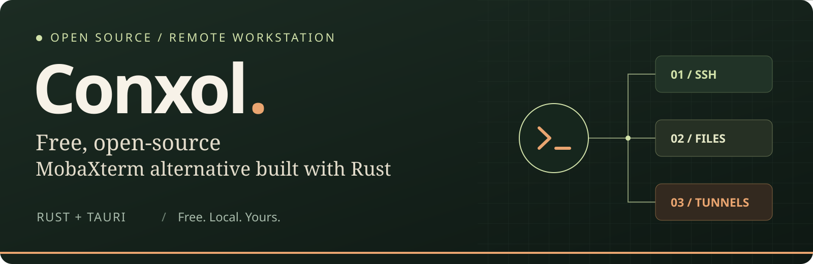
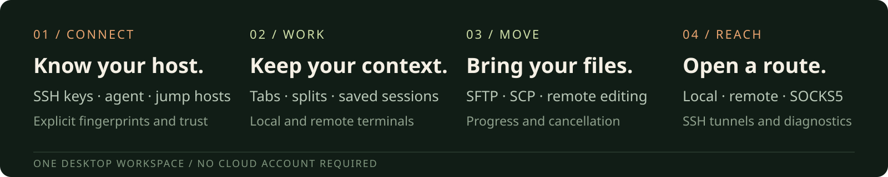

<div align="center">



**Open-source terminal and network workspace built with Rust**

SSH • SFTP/SCP • terminal tabs & splits • remote editing • tunnels • reviewed automation

[](https://github.com/thetonmoyroy/Conxol/releases/tag/v0.1.54)
[](docs/architecture.md)
[](LICENSE)

**[⬇️ Download](#download)** · **[🧭 Roadmap](ROADMAP.md)** · **[📖 Docs](docs/architecture.md)** · **[🤝 Contribute](CONTRIBUTING.md)**

</div>

## What makes Conxol different

Conxol's additions and refinements focus on a compact desktop workflow, device-oriented tools, and keeping diagnostics beside your terminal.

| Conxol addition or refinement | What it gives you |
| --- | --- |
| **Reworked desktop and session sidebar** | A compact menu and activity strip, full-height terminals, a resizable sidebar, inline SSH file browsing, custom folder/host icons and colors, and compact session action menus. |
| **SSH session branching** | Open another independent shell in a split using the existing authenticated connection. Branches have separate input/output and skip startup commands; split groups and sizes are remembered during the app run. |
| **Floating network diagnostics** | Move diagnostics beside your terminal, minimize them while probes keep running, and export the displayed report as text. |
| **CIDR scans and built-in DNS reports** | Scan bounded IPv4/IPv6 ranges with aggregate progress and confirmed open-port results. Inspect DNS records, TTLs, headers, resolver, timing and transport without an external `dig` executable. |
| **Network configuration generator** | Turn command templates and nested numeric loops into repeatable configuration text, with previews and bounded output. |
| **Device-scoped command shortcuts** | Search shared or device-specific commands with a double Shift tap, or save a selected command from the terminal. Shortcuts paste one line without automatically executing it. |
| **Editable terminal highlighting** | Customize word groups and literal matches for network output, save your own rules, and apply them to live terminal scrollback. |
| **FTP / FTPS and TFTP tools** | Transfer files outside the SSH browser, or explicitly start a read-only TFTP server for one selected file, with progress and cancellation controls. |
| **Workspace PIN and encrypted backups** | Protect the workspace with a 4–12 digit numeric PIN and create password-encrypted `.cxb` backups covering sessions, settings, shortcuts, notes, trust data and required credentials. Restore includes a preview before activation. |
| **SSH login and troubleshooting refinements** | In-terminal secret prompts, automatic authentication selection, Windows OpenSSH-agent/Pageant support, RSA-SHA2 host verification and sanitized support-diagnostic export. |

[Workflow and implementation details](docs/architecture.md) · [Shortcut guide](docs/keyboard-shortcuts.md) · [Download the Windows release](#download)

These highlights describe Conxol's development focus and implemented changes. They do not claim exclusive ownership of the underlying terminal, SSH, or file-transfer technology. Protocol and platform limitations are listed below.

## ✨ One workspace, from connection to completion



<table>
<tr>
<td width="50%" valign="top">

### 🖥️ Keep your terminals together

Local shells and SSH terminals share a workspace. Open tabs, split panes, search scrollback and keep independent tasks in view. Organize saved sessions with **folders, tags, favorites, recents and search**.


</td>
<td width="50%" valign="top">

### 📂 Work directly with remote files

Browse SFTP files, download or upload, and edit remote text without leaving the app. Transfers expose **progress and cancellation**; the editor checks for remote changes before saving.


</td>
</tr>
<tr>
<td width="50%" valign="top">

### 🔐 Make trust explicit

Connect with passwords, keys, encrypted keys or an SSH agent. Verify unknown host fingerprints, import an OpenSSH config deliberately, and use **jump hosts** to reach another network. Saved profiles hold credential references.

</td>
<td width="50%" valign="top">

### 🌐 Reach the services you need

Create **local or remote forwards and SOCKS5 proxies** with explicit bind addresses. Inspect tunnel state and byte counts; stop a listener when you're done. Network diagnostics and SSH monitoring are available on demand.

</td>
</tr>
<tr>
<td width="50%" valign="top">

### 🧩 Review before you automate

Save snippets with variables and a rendered preview. Review macros before running them. Broadcast input uses selected targets and an emergency disable, so remote execution stays deliberate.

</td>
<td width="50%" valign="top">

### 🌗 Make it your workspace

Switch light/dark themes, adjust terminal fonts and shortcuts, and keep settings locally. **No cloud account required.** Telnet and serial are also available, with their unencrypted transport boundaries made explicit.

</td>
</tr>
</table>

<a id="download"></a>

## Download Conxol 0.1.54

**[Get Conxol from the Microsoft Store (Windows)](https://apps.microsoft.com/store/detail/9NZVQ7W665BH?cid=DevShareMCLPCS)**

**[Download the Windows x64 installer](https://github.com/thetonmoyroy/Conxol/releases/download/v0.1.54/Conxol-0.1.54-windows-x64.exe)** · [All release files, notes and SHA-256 checksums](https://github.com/thetonmoyroy/Conxol/releases/tag/v0.1.54)

| Platform | Download |
| --- | --- |
| macOS Apple Silicon (M1 and newer) | [ARM64 DMG](https://github.com/thetonmoyroy/Conxol/releases/download/v0.1.54/Conxol-0.1.54-macos-arm64.dmg) |
| macOS Intel | [x64 DMG](https://github.com/thetonmoyroy/Conxol/releases/download/v0.1.54/Conxol-0.1.54-macos-x64.dmg) |
| Linux x64 Debian/Ubuntu | [DEB](https://github.com/thetonmoyroy/Conxol/releases/download/v0.1.54/Conxol-0.1.54-linux-x64.deb) |
| Linux x64 portable | [AppImage](https://github.com/thetonmoyroy/Conxol/releases/download/v0.1.54/Conxol-0.1.54-linux-x64.AppImage) |

Open the DMG and move Conxol to Applications. Both Mac packages are ad hoc signed and not notarized; the standalone Windows installer is unsigned. The MSIX release asset is an unsigned Store upload package; use the Microsoft Store listing for installation. Native Ping/MTR currently support IPv4 on Windows and macOS, with IPv6 and Linux probing explicitly unsupported. RDP remains experimental and excluded from normal bundles.

## Features in the current source

- **Terminals:** local shells, Windows WSL, SSH, tabs and split panes, search, zoom, reconnect controls, custom syntax highlighting, themes and keyboard shortcuts.
- **Saved connections:** folders, favorites, recent sessions, custom names, compact row actions, quick connect and advanced SSH settings.
- **SSH security and access:** interactive password prompts, supported private keys, OpenSSH agent and Windows Pageant support, explicit host fingerprint approval, saved trust pins, jump hosts, and RSA-SHA2 server host verification. RSA private-key authentication remains unsupported.
- **Remote files:** SFTP browsing, SCP/SFTP transfers, remote text editing, progress, cancellation and conflict checks.
- **Tunnels:** local and remote forwarding, SOCKS5 proxies, bind controls and traffic counters.
- **Network diagnostics:** ping, traceroute, MTR, CIDR-aware port scanning, native DNS reports, floating diagnostics and text report export. Scans show confirmed open ports and bounded aggregate progress.
- **Transfer tools:** FTP/explicit FTPS, TFTP client and an explicitly started read-only TFTP server. System curl protocol support is required for the transfer client.
- **Productivity:** command shortcuts, network configuration generator, notes, snippets, macros and reviewed broadcast input.
- **Workspace protection:** numeric 4–12 digit PINs, workspace lock, local credential storage, encrypted portable vaults, and workspace backup/import.
- **Additional protocols:** Telnet, serial, VNC helper integration and external X11 forwarding. RDP is a separate experimental helper with release restrictions.

See [architecture](docs/architecture.md), [keyboard shortcuts](docs/keyboard-shortcuts.md), [roadmap](ROADMAP.md) and [release notes](docs/release/v0.1.53.md) for implementation details and limits. Real-device and cross-platform acceptance varies by feature; included source does not imply every protocol has production interoperability coverage.

## 🛡️ Keep trust and data local

Rust owns protocols, processes, saved credentials and persistence. Unknown SSH host keys are not silently accepted. Multiline paste and remote execution have explicit review boundaries. VNC TCP and Telnet are unencrypted; experimental support is documented separately.

**Local test safety:** protocol fixtures listen only on `127.0.0.1` or `::1`, with disposable data and generated credentials. They do not enable Remote Login, change firewall/router rules or expose a home-network port. Native checks use an isolated app copy; owned test processes are stopped afterwards. [Testing boundaries](docs/security/safe-testing.md).

[Threat model](docs/security/threat-model.md) · [Dependency audit](docs/security/dependency-audit.md) · [Private vulnerability reporting](SECURITY.md)

<details>
<summary><strong>🛠️ Build and contribute</strong></summary>

Use Rust stable **1.90+**, Node.js **22**, pnpm **10**, and the [native Tauri prerequisites](CONTRIBUTING.md).

```bash
git clone https://github.com/thetonmoyroy/Conxol.git Conxol
cd Conxol
pnpm install --dir apps/desktop --frozen-lockfile
cargo xtask check
pnpm --dir apps/desktop tauri dev
```

```bash
cargo xtask test-ssh    # Disposable OpenSSH lab on Unix
cargo xtask check-rust  # Native workspace tests and Clippy
```

The full check covers frontend, Rust, isolated protocol helpers, package layouts and fuzz compilation. Fixtures use disposable state and generated credentials.

[Contributing](CONTRIBUTING.md) · [Architecture](docs/architecture.md) · [Safe testing](docs/security/safe-testing.md) · [Benchmarks](benchmarks/README.md)

</details>

## Acknowledgements

Conxol builds on [MobaRust](https://github.com/OthmaneBlial/MobaRust), created by Othmane Blial and its contributors. Thank you for creating the original project and making its foundation available as open source.

<div align="center">

**Build your next remote workspace with us.**

[Report a bug](https://github.com/thetonmoyroy/Conxol/issues/new/choose) · [Explore the roadmap](ROADMAP.md) · [Star Conxol ⭐](https://github.com/thetonmoyroy/Conxol/stargazers)

Licensed under [Apache-2.0](LICENSE). See [copyright and third-party notices](NOTICE).

</div>
